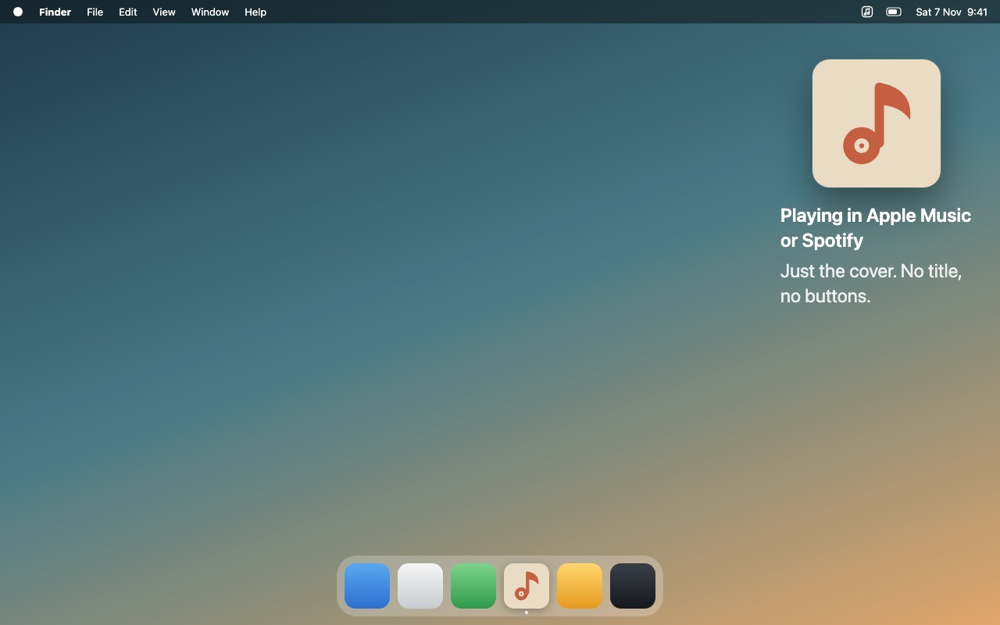

# Album Artwork

A small native macOS app that puts the cover of the song you're playing in **Apple Music** or **Spotify** on your desktop. It's a 164 × 164 pt rounded tile with no controls. Drag it wherever you like, and it keeps showing the last cover when you pause or quit the player.



*Simulated desktop screenshot with original demo artwork.*

## Features

- Works with Apple Music and Spotify. Whichever is playing is shown.
- Drag anywhere on the cover to move it. It snaps to a proposed outline when you drop it near another widget or a screen edge.
- Remembers its position, visibility and last cover across launches.
- Sits behind ordinary windows on desktop Spaces. No Dock icon.
- Menu bar icon (or right-click the tile) for **Show/Hide Artwork**, **Reset Position** and **Quit Album Artwork**.
- Native and dependency-free: Apple frameworks only, no server, no analytics, no account, no API key.

## Requirements

- macOS 14 or later
- Xcode command line tools (to build)

## Build and run

```sh
bash scripts/build.sh
open "build/Album Artwork.app"
```

The script produces a release `.app` for your Mac's architecture, signed ad hoc with the Apple Events entitlement. To edit the source, open `Package.swift` in Xcode, but run the bundled `.app` for normal use rather than the bare SwiftPM executable.

## Usage

1. Launch the app and play a song in Apple Music or Spotify. The app never starts a player or changes playback.
2. Approve the macOS Automation prompt for each player (Music, Spotify) the first time.
3. Drag the tile into place.

Behavior to know about:

- **Two players:** the one that is playing wins. If both are idle, the last shown player stays, so quitting one never swaps in the other's paused cover.
- **Pause, stop, quit:** the cover stays visible, and a saved cover reappears after restarting the app.
- **Missing artwork:** a neutral music-note tile is shown. Retries happen after 1, 2, 4, 8 and 16 seconds, then the app waits for a different track.
- **Access denied:** the menu offers **Open Automation Settings…** and **Retry Music Access**. Enable access under **System Settings → Privacy & Security → Automation**. If you launched from a development tool, macOS may attribute the request to that tool.

The tile is a regular desktop app, so it does not appear in macOS's Edit Widgets gallery. **Launch at Login** in the menu bar menu registers the app as a login item (manage it in System Settings → General → Login Items).

## How it works

Each running player is polled once per second.

- **Apple Music:** JXA ([metadata.js](Sources/AlbumArtwork/Scripts/metadata.js)) reads track metadata and AppleScript ([artwork.applescript](Sources/AlbumArtwork/Scripts/artwork.applescript)) extracts the raw image through Music's scripting interface.
- **Spotify:** [spotify-metadata.js](Sources/AlbumArtwork/Scripts/spotify-metadata.js) reads the `artwork url` Spotify reports, and [SpotifyArtworkLoader.swift](Sources/AlbumArtwork/SpotifyArtworkLoader.swift) downloads it. Only HTTPS URLs on `*.scdn.co` and `*.spotifycdn.com` are fetched, using an ephemeral session with a 5-second timeout and a 10 MB cap.
- **Safety:** player selection and URL validation live in [PlayerSource.swift](Sources/ArtworkCore/PlayerSource.swift). Requests are serialized, time out after 5 seconds (60 seconds for the first request or a permission retry, to allow for the prompt) and are cancelled on exit. Track identity is checked before and after extraction, and again before display, so rapid skipping can't show a stale cover.

### Local data

| What | Where |
| --- | --- |
| Last cover and track metadata | `~/Library/Application Support/AlbumArtwork/last-artwork.json` |
| Window position and hidden state | Preferences domain `com.local.AlbumArtwork` |

The cached cover is deleted when a new track is detected, so an unrelated album is never restored later. Your music library is never modified.

## Project layout

| Path | Contents |
| --- | --- |
| `Sources/AlbumArtwork` | App, tile UI, artwork store, Spotify loader, player scripts |
| `Sources/ArtworkCore` | Playback model, player selection, tile placement, command runner |
| `Tests/` | `ArtworkCoreTests` and `DesktopTileTests` |
| `Support/` | `Info.plist` and entitlements |
| `scripts/` | `build.sh`, `test.sh` and `release.sh` |
| `docs/releases/` | Release notes, one file per version |
| `docs/` | README preview image |

## Testing

```sh
bash scripts/test.sh
codesign --verify --strict "build/Album Artwork.app"
```

Tests cover pause/stop/close retention, stale results after rapid skipping, bounded retries, metadata escaping, permission-error detection, subprocess failure/timeout/cancellation, and screen-placement recovery. Live results and remaining manual checks are in [VALIDATION.md](VALIDATION.md).

## Releasing

1. On `main`, set `CFBundleShortVersionString` (and bump `CFBundleVersion`) in `Support/Info.plist`.
2. Write the notes in `docs/releases/<version>.md`, then commit and push.
3. Run:

```sh
bash scripts/release.sh
```

The script refuses to run unless you're on a clean `main` that matches `origin/main`. It runs the tests, builds a universal app, writes `dist/Album-Artwork-<version>.zip` and its `.sha256`, tags `v<version>` and publishes the GitHub release with both files and the checksum in the notes. Use `--dry-run` to only build and package, `--draft` for a draft release.

## Limitations

Ad hoc signing is meant for local use; distribution and notarization are out of scope. Rebuilding may make macOS ask for Automation permission again.

## Demo assets and copyright

- Use original, fictional artwork for screenshots and demos, and label simulated screenshots as such.
- Don't commit commercial album artwork or covers downloaded from Apple Music or Spotify.
- Keep demo assets separate from artwork fetched during normal operation.

See [AGENT.md](AGENT.md) for contributor notes.
